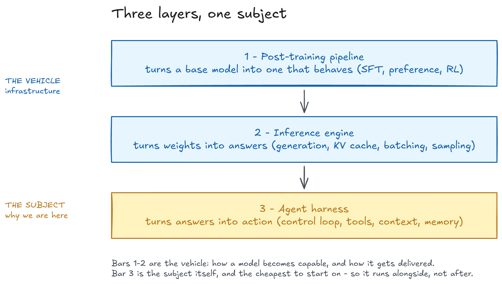
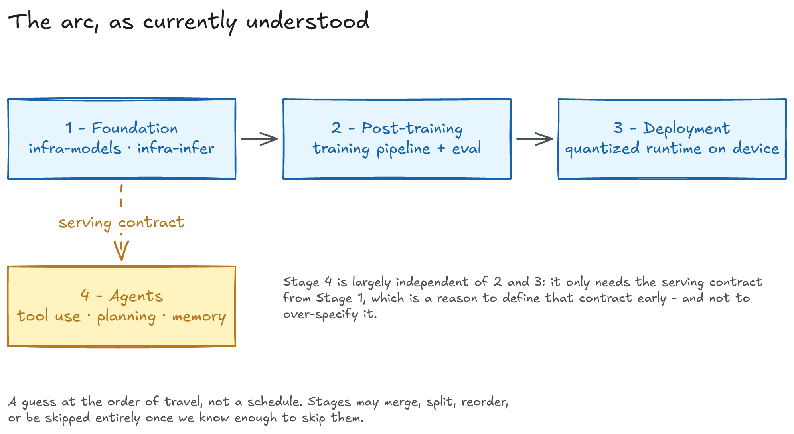
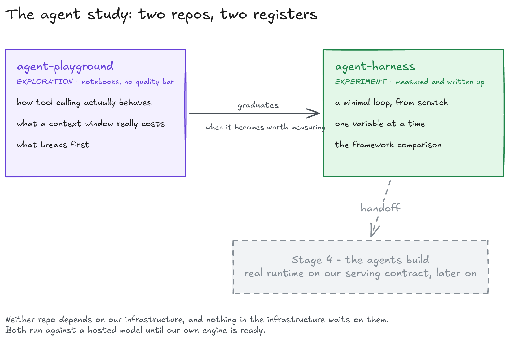

# project_a

**Studying the artificial half of AI agents** - the scaffolding a human has to design, measure, and get right, rather than the intelligence a model is given.

[What this is](#1-what-this-project-is) · [Why](#2-why-were-doing-it) · [Our approach](#3-how-were-approaching-it) · [Repos](#4-repositories-and-naming) · [First threads](#5-first-threads) · [The arc](#6-the-arc-as-currently-understood) · [The agent study](#7-sub-project-the-agent-study) · [Open questions](#9-open-questions-and-current-hunches) · [Diagrams](#diagrams)

## Contents

1.  [What this project is](#1-what-this-project-is)
2.  [Why we're doing it](#2-why-were-doing-it)
3.  [How we're approaching it](#3-how-were-approaching-it)
4.  [Repositories and naming](#4-repositories-and-naming)
5.  [First threads](#5-first-threads)
6.  [The arc, as currently understood](#6-the-arc-as-currently-understood)
7.  [Sub-project: the agent study](#7-sub-project-the-agent-study)
8.  [Working agreements](#8-working-agreements)
9.  [Open questions and current hunches](#9-open-questions-and-current-hunches)
10.  [Use of AI](#10-use-of-ai)
11.  [Diagrams](#diagrams)

* * *

## 1. What this project is

**A learning project.** We are studying the _artificial_ aspects of AI agents - the engineered scaffolding around a model, as opposed to the model's intelligence itself. The parts a human has to design, measure, and get right: how a model is post-trained, how it is served, how its context and tools are managed, how its behavior is constrained.

Note the word "agents" doing double duty. It is the **subject** - the scaffolding is what we're studying - and also our **means**: we work with AI agents as collaborators, for implementation, review, investigation, and the unglamorous parts of the pipeline.

What we are building, as the vehicle for that study. Three layers, one subject:

1.  **A post-training pipeline** - supervised fine-tuning, preference optimization, and reinforcement learning on a small model. Turns a base model into one that behaves the way we want.
    
2.  **An inference engine** - a runtime that serves that model efficiently, including on low-power embedded hardware. Turns weights into something that answers.
    
3.  **An agent harness** - the control loop, tool use, context management, and memory wrapped around the model, built from scratch rather than adopted, and measured rather than assumed (the [`agent-playground` and `agent-harness` sub-project](#7-sub-project-the-agent-study)). Turns answering into acting.
    

The first two are infrastructure: how a model becomes capable, and how it gets delivered. The third is the part the first two exist to make possible - the subject itself rather than its enabler, and the piece we care about most. It is also the cheapest to start on, which is why it runs alongside the infrastructure work instead of waiting for it ([§3](#3-how-were-approaching-it), [§7](#7-sub-project-the-agent-study)).

The work is deliberately first-principles across all three: we do not delegate the core of any of them to [llama.cpp](https://github.com/ggml-org/llama.cpp), [vLLM](https://github.com/vllm-project/vllm), [TRL](https://github.com/huggingface/trl), [Axolotl](https://github.com/axolotl-ai-cloud/axolotl), or an agent framework. Where we reuse a library, we say why and what it does. The reasoning is that a framework hides exactly the parts we came here to learn - and for agents we make a point of it, because reimplementing what a framework does for you is how you find out what it was doing.

**The distinction that shapes everything below:** a model's capability is largely given to us. The agent built on top of it is not. We are studying the second part.

* * *

## 2. Why we're doing it

**The learning objective** is the primary one. Everyone here wants to understand post-training, inference, and agent engineering well enough to build them, not just configure them. The parts we keep are the parts existing frameworks don't package: data curation, reward design, KV-cache economics, agent behavior - the artificial decisions.

**The shipping objective** is secondary but real: a quantized, efficient runtime serving a fine-tuned small model on an embedded device. It exists to keep the learning honest. A working artifact is the only reliable proof that the understanding is real. The same holds for the agent work: a loop we built ourselves, doing something genuinely useful, is the proof - a framework we configured tells us nothing we didn't already assume.

**Non-goals**, stated plainly so nobody expects them:

*   Training a frontier model
    
*   Beating published benchmarks
    
*   Building a general-purpose serving product
    
*   Building a general-purpose agent product or framework of our own
    
*   Rebuilding autograd, GPU kernels, or tokenizer training from scratch
    

* * *

## 3. How we're approaching it

**Exploratory, in small steps.** We do not yet know enough to write a plan worth following, so this document is a snapshot of current thinking rather than a commitment. It is expected to be wrong in places, and revising it is normal work, not a failure of discipline. Where this document disagrees with something we've learned, the finding wins and the document gets edited.

Some things that follow from that:

*   **Prefer findings to forecasts.** No dates, no week estimates, no burndown. We travel as far as the understanding takes us and then re-decide.
    
*   **Decide late, on the smallest thing that settles the question.** Where a decision can be deferred without blocking anyone, it gets deferred - that's cheap. Where it blocks, we make it quickly and write down why.
    
*   **Timebox, don't deadline.** If a thread runs long, we cut its scope, not the quality of the understanding we take from it.
    
*   **A dead thread is a result.** Investigating something and concluding it doesn't matter is worth writing up, not worth hiding. We should expect some of the [threads](#5-first-threads) and [agent-study](#7-sub-project-the-agent-study) directions to be abandoned.
    
*   **Small written decisions.** Short notes - one page, timestamped, what we chose and what would change our mind - so a part-time team can re-enter the work cold, and AI collaborators get context they weren't present for.
    
*   **The structure is the cheap part.** [Naming conventions and repo boundaries](#4-repositories-and-naming) are worth fixing early because they cost little. Everything downstream of that is provisional.
    

Right now we are **preliminary**: nothing implemented, several investigations running, and a roughly guessed order of travel. If you're joining, expect to help shape the design rather than implement against a finished spec.

* * *

## 4. Repositories and naming

Two categories, and the naming tells you which you're in:

| Category | Naming | Meaning |
| --- | --- | --- |
| **Infrastructure** | `infra-` prefix | Depended on by other repositories. Must stay stable. |
| **Application** | no prefix | Standalone app, service, or demo. Free to change. |

The prefix is a stability promise, not just a label. Breaking an `infra-` repo is a coordination event; breaking an unprefixed one is just your afternoon.

We currently expect two infrastructure repos and a handful of application repos. The specific list will change as we learn - what stays fixed is the convention, not the contents.

| Repo | Status | What it's for |
| --- | --- | --- |
| `infra-models` | first thread | Describes what a model is - its configuration, structure, and inputs |
| `infra-infer` | first thread | Runs a model - generation, caching, batching, sampling |
| `posttrain` | someday | Training recipes |
| `eval` | someday | Evaluation |
| `serve` | someday | Serving package |
| `agents` | someday | The [Stage 4](#6-the-arc-as-currently-understood) build |
| `agent-harness`, `agent-playground` | now | The [agent study sub-project](#7-sub-project-the-agent-study) |

"First thread" means we're actively circling it, not that it's designed. "Someday" means we've noticed it exists. If a repo on this list turns out not to be needed, it comes off the list.

* * *

## 5. First threads

Not milestones - threads of investigation. We pull on them in rough parallel, follow what's interesting, and write down what we find. Each has a question and a signal that we've learned what it had to teach; neither is a permission slip to proceed.

| Thread | The question | A good sign we're through it |
| --- | --- | --- |
| **Model reconnaissance** | What is our first model, actually - verified first-hand, not from a blog post? | Our own description of it, which the team trusts more than any public writeup |
| **Foundation shape** | What structure do the other repos build against? | The skeleton exists and is testable, before a model is inside it |
| **Reference path** | Can we run the model ourselves and show the output is right? | Output matches an independent reference, and we can explain any divergence |
| **Engine** | Can we generate efficiently and measure it? | Generation works, caching is correct, numbers are recorded |
| **Generality** | Does any of this survive a second, different model? | A second model runs through the same path with no engine changes - or we learn precisely why not, which is itself the finding |

The last one is the one we care most about. **One model working proves we built something that runs. Two models working, without changing the engine, is the evidence that we built something that generalizes** - and a writeup explaining why a second model _couldn't_ fit is nearly as useful, because it tells us where the abstraction actually lives.

**Things we've decided not to chase yet:** training runs, evaluation scoreboards, quantization, device deployment, the Stage 4 agent build. Pulling these forward is the failure mode we're most likely to hit, so we name them here. Note that this is a decision, not a prohibition - if a finding makes one of them the obvious next move, we take it and say so. The [agent study](#7-sub-project-the-agent-study) is the existing exception: study and exploration, not builds.

* * *

## 6. The arc, as currently understood

A guess at the order of travel, not a schedule. Stages are allowed to merge, split, reorder, or get skipped when we know enough to skip them.

| Stage | Deliverable | Depends on |
| --- | --- | --- |
| **1 - Foundation** | Model and inference infrastructure | - |
| 2 - Post-training | Training pipeline + evaluation | Stage 1 |
| 3 - Deployment | Quantized runtime on target hardware | Stage 2 |
| 4 - Agents | Tool use, planning, memory | Stage 1's serving contract |

Stages 2 and 3 each split into a framework (infrastructure) and a set of recipes or packaging (application). Stage 4 is largely independent of 2 and 3 and can begin as soon as Stage 1's serving contract is defined - which is a reason to define that contract reasonably early, and a reason not to over-specify it.

Note that Stage 4 is where the project's subject matter - the artificial scaffolding of agents - becomes the work itself rather than the thing being enabled. Stages 1-3 exist to make Stage 4 possible.

* * *

## 7. Sub-project: the agent study

**A parallel exploration, not a stage.** The arc above puts agents at Stage 4, because building the real agent runtime wants a serving contract worth building on. But we shouldn't arrive there with no first-hand opinions about agent scaffolding. Two repos exist to fix that - `agent-playground` for exploration, `agent-harness` for experiment - forming a small, self-contained sub-project that studies the harness: the engineered scaffolding around a model ([§1](#1-what-this-project-is)) - context management, tool use, control loops, memory - by building minimal agents from scratch and seeing what each engineering choice actually does.

The conventions that keep it from eating the main project:

*   **Self-contained.** `agent-harness` and `agent-playground` are application repos (no `infra-` prefix, see [§4](#4-repositories-and-naming)). Nothing in the main arc depends on them, and they depend on none of our infrastructure. They run against a hosted model until our own engine is ready; switching over later is a convenience, not a goal.
    
*   **Findings first.** The deliverable is what we learned, not a product. Code is disposable evidence. Where a finding matters, it gets written down.
    
*   **Nothing blocks on it.** Sub-project work happens in leftover hours, and a direction here is a good candidate to abandon when it stops teaching us anything. We're not building memory systems, multi-agent frameworks, or our own eval harness until a question actually demands one.
    

**Two repos, two registers.** Exploration and experiment are kept apart, because they rot each other when mixed:

| Repo | Register | What belongs in it |
| --- | --- | --- |
| `agent-playground` | Exploration | Python-based interactive examples - [Jupyter notebooks](https://jupyter.org) and the like - for building agents from scratch, unmeasured. How tool calling actually behaves, what a context window really costs, what breaks first. No gates, no quality bar, no convention beyond "runs". Notebooks are lab notes, not deliverables. |
| `agent-harness` | Experiment | The same questions, but controlled, measured, and written up. |

The path between them is one-directional and informal: an idea usually starts as a notebook in `agent-playground`, and moves to `agent-harness` when it becomes worth measuring. That move is when a notebook stops being exploration and starts being an experiment - and when the [working agreements](#8-working-agreements) start applying to the code. Nothing forces a notebook to make the move.

**A starting set of threads**, not a checklist. Pick them up in any order, add better ones, drop the ones that go nowhere:

*   **A minimal tool-use loop, from scratch.** A few hundred lines - model call, tool execution, context assembly, the loop itself - doing something small and real. No agent framework anywhere in it, because the framework is the thing we're trying to understand. Most likely born in the playground first.
    
*   **One variable at a time.** Controlled experiments on the scaffolding: tool description wording, context packing strategy, when the loop stops or asks for help. Each with a documented measurement and result, so "it seemed better" becomes "it was better, by this much, in this setup."
    
*   **The framework comparison.** The same agent rebuilt on an existing framework, plus a writeup of what it does for you and what it hides - the parts we came here to learn ([§1](#1-what-this-project-is)).
    
*   **A handoff note for later.** What we'd keep, build ourselves, or avoid, and why - for whenever the Stage 4 build actually happens.
    

**Relationship to Stage 4:** Stage 4 remains the build - a real agent runtime on our serving contract. This sub-project is the study that makes that build a design from evidence rather than folklore.

* * *

## 8. Working agreements

Small team, part-time, with AI agents assisting throughout. These are the few rules we've found worth keeping; they exist to protect limited joint hours, not to control anyone.

*   **One maintainer per repository.** Shared ownership stalls on reviews. A repo can change hands; it just needs a named hand.
    
*   **Small, short-lived branches and PRs.** No long-running per-person branches.
    
*   **Version pins between repos, upgraded deliberately.** Not a ceremony - just so a bad upgrade shows up somewhere specific instead of everywhere at once.
    
*   **Decisions get written down.** A paragraph beats a memory. This is how a part-time team survives gaps between sessions, and how agent collaborators get context they weren't present for.
    
*   **Say when the plan changes.** Changing direction is fine and expected; changing direction silently is what costs us. A one-line note in the relevant doc or issue is enough.
    

* * *

## 9. Open questions and current hunches

The following are **open**. Some are being actively investigated; others we've only noticed. They get written up as they resolve, not before - and a hunch is worth recording even when it's unverified, as long as it's labelled as one.

*   Which model is our first target, and what is its verified configuration
    
*   What the embedded hardware target is, and which constraints actually bite
    
*   What "good enough" means for performance and quality
    
*   Where the boundaries between repositories should fall
    
*   Which second model would best test whether the foundation generalizes
    
*   How we evaluate any of this - criteria, benchmarks, or less formal proxies
    
*   `agent-harness`: the hosted model, the small task set for the first loop, which experiments are worth running, and whether the Stage 4 build should split harness from agents at all
    
*   `agent-playground`: which notebook environment and tooling, and what it owes `agent-harness` beyond the informal graduation rule
    
*   Design criteria for the Stage 4 [`agents`](#6-the-arc-as-currently-understood) repo
    

* * *

## 10. Use of AI

**Is this AI slop?** - **Yes, it is** would be the short answer. In fact, most of the code including this README document will be generated by AI - and the `agent-harness` sub-project is, fittingly, agents studying how to build their own kind. Therefore, you should not be running this in any kind of production environment. ~~Although at least one human should review the code before pushing it to GitHub~~

* * *

## Diagrams

Every diagram in this README is drawn with [Excalidraw](https://excalidraw.com) and committed in two forms:

| Diagram | Editable source | Rendered |
| --- | --- | --- |
| [Three layers, one subject](#1-what-this-project-is) | [`01-three-layers.excalidraw`](docs/diagrams/01-three-layers.excalidraw) | [PNG](docs/diagrams/01-three-layers.png) · [SVG](docs/diagrams/01-three-layers.svg) |
| [The agent study](#7-sub-project-the-agent-study) | [`02-agent-study.excalidraw`](docs/diagrams/02-agent-study.excalidraw) | [PNG](docs/diagrams/02-agent-study.png) · [SVG](docs/diagrams/02-agent-study.svg) |
| [The arc](#6-the-arc-as-currently-understood) | [`03-the-arc.excalidraw`](docs/diagrams/03-the-arc.excalidraw) | [PNG](docs/diagrams/03-the-arc.png) · [SVG](docs/diagrams/03-the-arc.svg) |

The `.excalidraw` files are the source of truth - edit those, then re-export the PNG and SVG. To open one, drag it onto [excalidraw.com](https://excalidraw.com); nothing in the diagrams is generated from code, so a diagram that drifts from this document is a bug in the diagram.
